# CYBERCORE — Cyborg-Themed Landing Page

> A futuristic, responsive cyborg-themed landing page with a clean white default theme, a working light/dark switch, immersive animations and interactive UI components.

CYBERCORE is a single-page, production-ready front-end experience for a technology festival / cyber-tech brand. It is a **fictional interface**: the telemetry, node readouts and system status lines are design storytelling, not real product metrics.

---

## Features

- **Two themes, one click** — the page ships **light by default** (pure white, near-black type, silver edges) and a `SWITCH TO DARK MODE` button in the top-right corner of the header converts the whole site to the near-black HUD palette, relabelling itself `SWITCH TO LIGHT MODE`. The choice is stored in `localStorage` and re-applied by a pre-paint script so a saved theme never flashes. See [Theming](#theming).
- **Sticky HUD navigation** — glass background that solidifies on scroll, active-section highlighting, `ENTER THE SYSTEM` CTA, and a working mobile menu (`Escape` closes, `aria-expanded`/`inert` state, tap targets ≥ 44 px).
- **Full-screen hero** — `HUMANITY / REDEFINED.` display lockup, generated cyborg portrait inside a HUD frame, rotating targeting rings, scanning beam, floating particles, `SYSTEM ONLINE / AI CORE ACTIVE / NEURAL LINK STABLE` readouts and a scroll cue.
- **Telemetry strip** — animated count-up for `99.9%` and `24/7`, plus `AI-CORE` and `∞` cells, with an explicit note that the numbers are fictional interface telemetry.
- **Technology modules** — four cards (Neural Integration, Cybernetic Robotics, Artificial Intelligence, Human Augmentation) with unique icons, technical identifiers (`MOD-01 // NEURAL`), elevation and border-illumination on hover/focus.
- **Immersive experience** — split layout with a large visual, three feature highlights and a `DISCOVER THE SYSTEM` action that scrolls to the technology section.
- **Interactive cyber interface** — a genuinely working control panel: circular radar sweep, standby/active indicator states, four animated progress bars, an SVG connection topology graph, a system log, and an `ACTIVATE SYSTEM` ⇄ `SYSTEM ACTIVE` toggle that changes every readout (announced through an `aria-live` region).
- **Call to action** — `BEGIN YOUR EVOLUTION` opens a real, focus-trapped modal dialog (no fake registration, form or payment) that explains the concept and links to this repository.
- **Footer** — logo, brand description, quick navigation, repository link, current-year copyright and a system-status indicator.
- **Craft details** — scroll-reveal animations, cursor-reactive lighting on fine-pointer devices, self-hosted subset fonts, custom SVG favicon, full SEO/Open Graph/Twitter metadata, keyboard focus rings, and a `prefers-reduced-motion` mode that disables particles, scanning beams and transitions.

## Tech stack

| Concern | Choice |
| --- | --- |
| Framework | React 19 + TypeScript 6 |
| Build tool | Vite 8 (`@vitejs/plugin-react`) |
| Styling | Tailwind CSS v4 via `@tailwindcss/vite`, design tokens in `@theme`, custom CSS keyframes |
| Icons | `lucide-react` |
| Motion | `framer-motion` (`whileInView` reveals, count-up telemetry, cursor lighting) + CSS keyframes for the ambient HUD loops |
| Imagery | Locally generated, WebP-compressed assets imported through the bundler |
| Fonts | Self-hosted latin subsets of Chakra Petch, Rajdhani and Share Tech Mono (SIL OFL) |

No runtime network requests are made: fonts and images are served from the bundle, so nothing can break offline or hotlink.

## Getting started

Prerequisites: **Node.js 20.19+** (or 22.12+) and npm.

```bash
npm install       # install dependencies
npm run dev       # start the dev server (http://localhost:5173)
```

### Available scripts

| Command | Description |
| --- | --- |
| `npm run dev` | Vite dev server with HMR |
| `npm run build` | Type-check (`tsc -b`) and produce the production bundle in `dist/` |
| `npm run preview` | Serve the built `dist/` folder locally |
| `npm run lint` | Oxlint over `src/` |

> `npm run lint` needs the `oxlint` native binary. On machines where Windows App Control / Smart App Control blocks unsigned native modules, that command fails with *"An Application Control policy has blocked this file"*. `npm run build` still runs the full TypeScript type-check, so the code stays verified.

## Project structure

```
.
├── LICENSE                    # MIT (c) 2026 panditbhavik15
├── index.html                 # metadata, OG tags, theme color, root mount
├── vite.config.ts             # react + tailwind plugins, relative base
├── public/
│   ├── favicon.svg            # custom cyber hex/core mark
│   └── og-image.webp          # social preview image
└── src/
    ├── main.tsx               # React root
    ├── App.tsx                # page composition + cursor lighting
    ├── index.css              # Tailwind import, design tokens, keyframes, HUD styles
    ├── fonts.css              # @font-face rules for the self-hosted subsets
    ├── fonts/                 # .woff2 subsets
    ├── hooks.ts               # useTheme, useFinePointer, useActiveSection (motion state comes from framer-motion)
    ├── lib/
    │   ├── site.ts            # nav model, section ids, repository URL
    │   └── styles.ts          # shared button / HUD label class tokens
    ├── assets/                # hero + experience WebP images (2 widths each)
    └── components/
        ├── Navbar.tsx
        ├── ThemeToggle.tsx    # light/dark switch, wired to localStorage
        ├── Hero.tsx
        ├── Stats.tsx
        ├── Technology.tsx
        ├── SystemInterface.tsx
        ├── Experience.tsx
        ├── CallToAction.tsx   # includes the accessible modal dialog
        ├── Footer.tsx
        ├── Reveal.tsx         # framer-motion whileInView scroll-reveal wrapper
        └── ui.tsx             # Logo, StatusDot, StatusPill, SectionHeading
```

## Design system

Every colour in the UI is a **semantic token**, never a literal. `src/index.css` declares two value sets and maps them onto Tailwind utilities through `@theme`:

| Token | Role | Light (default) | Dark (`html.dark`) |
| --- | --- | --- | --- |
| `void` | page background | `#ffffff` | `#04060c` |
| `abyss` | banded sections | `#f2f5fa` | `#070b16` |
| `graphite` / `panel` | cards, dialogs | `#f7f9fc` / `#ffffff` | `#0b1120` / `#0f1728` |
| `line` | borders, dividers | `#d5dde8` (silver) | `#1c2a45` |
| `ink` | headings, wordmark | `#060a12` | `#ffffff` |
| `mist` | body copy, ghost buttons | `#1b2637` | `#cfdcf0` |
| `steel` | muted HUD labels | `#4a5a71` | `#8ea3c4` |
| `neon` | primary accent | `#0a6a83` | `#2ee6ff` |
| `electric` / `plasma` | gradients, secondary accents | `#2f6fed` / `#7c3aed` | `#4c7dff` / `#a855f7` |
| `amber` | standby / attention states | `#b45309` | `#ffb020` |

- **Type** — `--font-display` (Chakra Petch) for headings, `--font-body` (Rajdhani) for copy, `--font-mono` (Share Tech Mono) for HUD labels.
- **Type scale** — `clamp()` driven hero lockup (`2.9rem → 5.75rem`), section headings at `text-4xl/5xl`, HUD labels at 10–11 px with wide tracking.
- **Effects** — shadows, grid lines, gradient washes and glows are their own variables (`--s-hud`, `--grid-line`, `--wash-*`, `--glow-*`), so the dark-mode bloom becomes a soft silver tint in light mode instead of an unreadable glare.
- Custom classes live inside `@layer components` so Tailwind utilities always win — that is what lets `.hud-panel` be re-positioned with `absolute`/`relative` utilities per use site.

## Theming

```
:root          { --c-void: #ffffff; … }   /* light — the default */
html.dark      { --c-void: #04060c; … }   /* dark  */
@theme         { --color-void: var(--c-void); … }
```

1. `useTheme()` (`src/hooks.ts`) keeps the current theme in React state, toggles the `dark` class on `<html>`, sets `color-scheme`, syncs the `theme-color` meta tag and writes `localStorage['cybercore-theme']`.
2. A tiny inline script in `index.html` reads the same key **before first paint**, so reloading in dark mode never shows a white frame.
3. Because `@theme` maps the utilities onto those variables, a single class flips everything at once — backgrounds, borders, text, `color-mix()` opacity variants, SVG `fill`/`stroke` classes and gradients. No component carries a hard-coded colour: the only literals in `src/` are the two `theme-color` values written by `useTheme()`.
4. `@custom-variant dark` is redefined to the class, so any future `dark:` utility follows the user's choice rather than the operating-system setting.
5. Light is the deliberate default: the stored value is the only thing that can start the page dark (the OS `prefers-color-scheme` is not consulted on first visit).
6. The crossfade is a zero-specificity `:where()` transition on colour-ish properties, so per-element `transition-*` utilities still win and `prefers-reduced-motion` cancels the animation entirely.

To add a third theme, copy the `html.dark` block to `html.oled` with new values — no component changes required.

## Accessibility

- Both themes were audited programmatically: **136 visible text nodes per theme all meet WCAG 2 AA** (4.5:1 for small text, 3:1 for large) against their composited backgrounds — gradient-clipped display text is checked against every stop of its gradient. Accent colours were darkened for light mode rather than reused from the dark palette.
- One `h1`, section `h2`s, card `h3`s; landmarks (`header`, `nav`, `main`, `footer`) plus a skip-to-content link.
- The theme control is a real `button` with an `aria-label`/`title` that states the full action (`Switch to Dark Mode` / `Switch to Light Mode`) at every width; the visible text shortens on narrow screens so the header never pushes the menu button out of reach.
- All interactive elements are real `button`/`a` elements with visible `:focus-visible` outlines and ≥ 40 px touch targets.
- The system panel uses `aria-pressed` on the toggle, `role="progressbar"` with live `aria-valuenow`, and an `aria-live="polite"` status line.
- The modal uses `role="dialog"`, `aria-modal`, initial focus, a Tab focus trap, `Escape`/backdrop close and focus restoration.
- Decorative SVGs, rings and particles are `aria-hidden`; both images carry descriptive alt text and fall back to a CSS-only gradient panel if decoding ever fails.
- `prefers-reduced-motion: reduce` removes particles, scanning beams and smooth scrolling; `<MotionConfig reducedMotion="user">` plus an explicit `useReducedMotion()` check make the reveals, count-ups and cursor lighting render their final state with no animation at all.

## Performance

- Hero and experience visuals are pre-compressed WebP (≈ 50–104 KB each, down from ~2 MB PNGs) with `srcset`/`sizes`; the below-the-fold image is `loading="lazy"`.
- Images declare `width`/`height` and the hero uses `fetchpriority="high"`, so there is no layout shift.
- Motion is limited to transform/opacity. framer-motion animates the reveals and telemetry through motion values, so the count-up never re-renders React per frame, and the cursor lighting writes two spring values instead of running a `requestAnimationFrame` loop; it never attaches on coarse pointers.
- Production bundle: ~128 KB gzipped JS (framer-motion is ~45 KB of that) and ~9.6 KB gzipped CSS.

## Screenshots

Captured from the production build at 1440 px (desktop) and 390 px (mobile). Light is the default theme; the last row shows the same page after one click of the header switch.

| Hero | Technology |
| --- | --- |
| 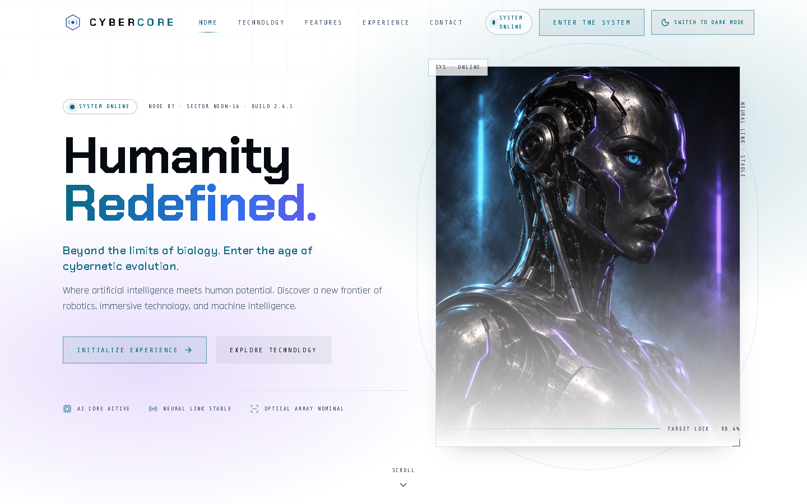 | 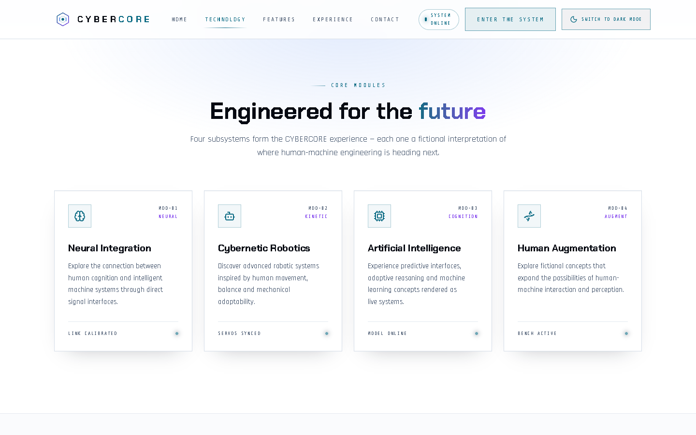 |

| System interface (standby) | System interface (activated) |
| --- | --- |
| 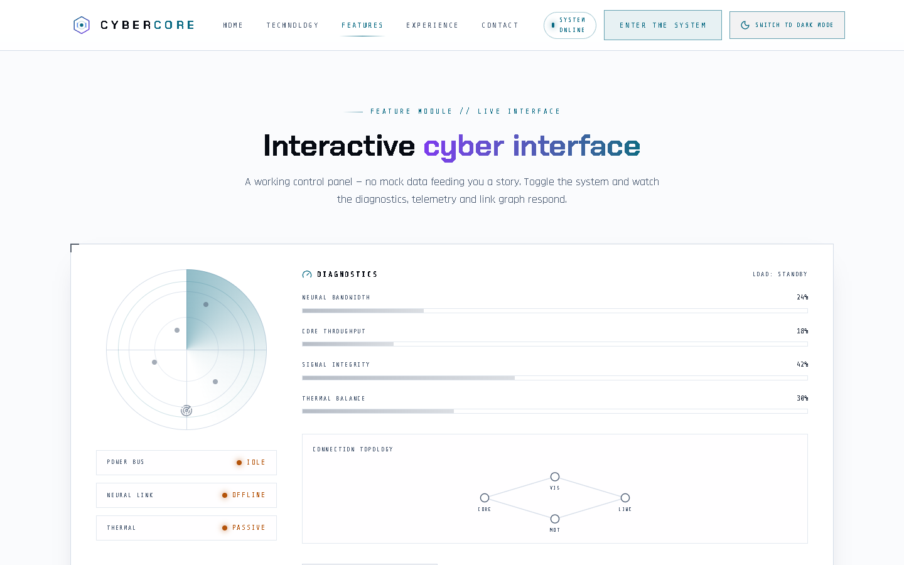 | 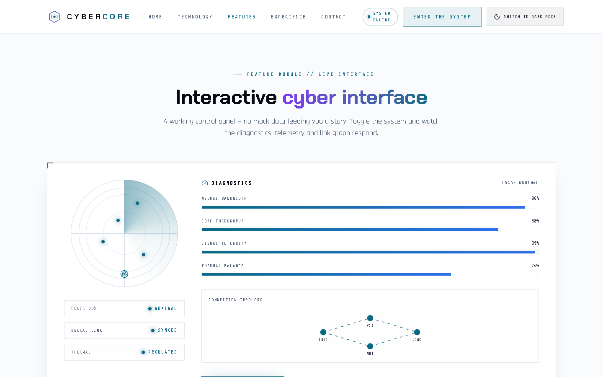 |

| Experience | Call to action |
| --- | --- |
| 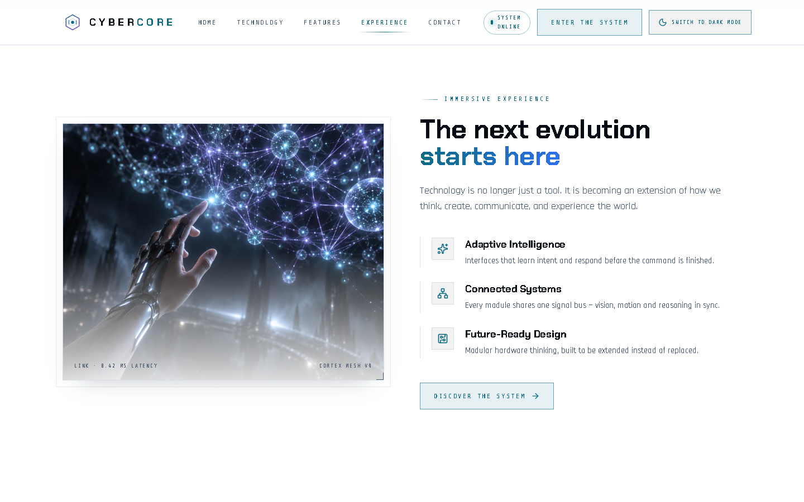 | 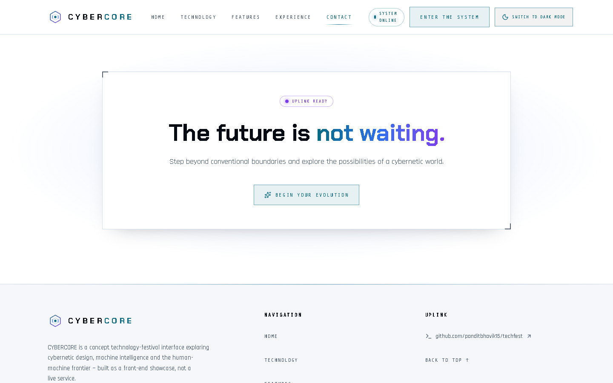 |

| Footer | Mobile | Mobile menu |
| --- | --- | --- |
| 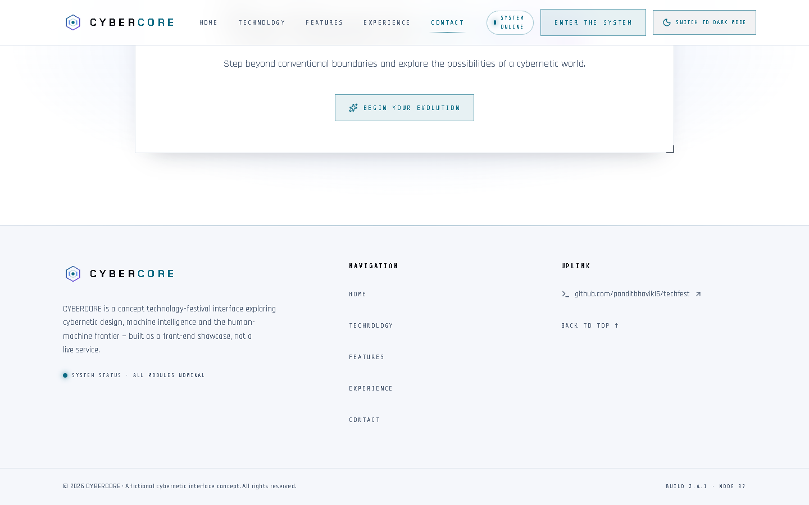 | 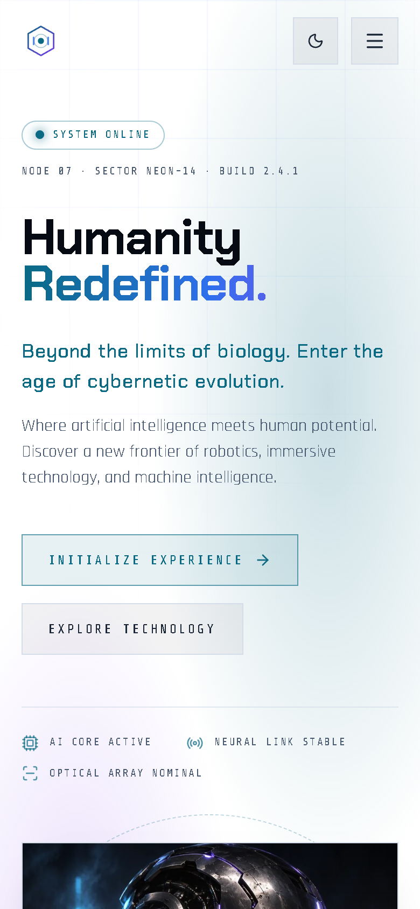 | 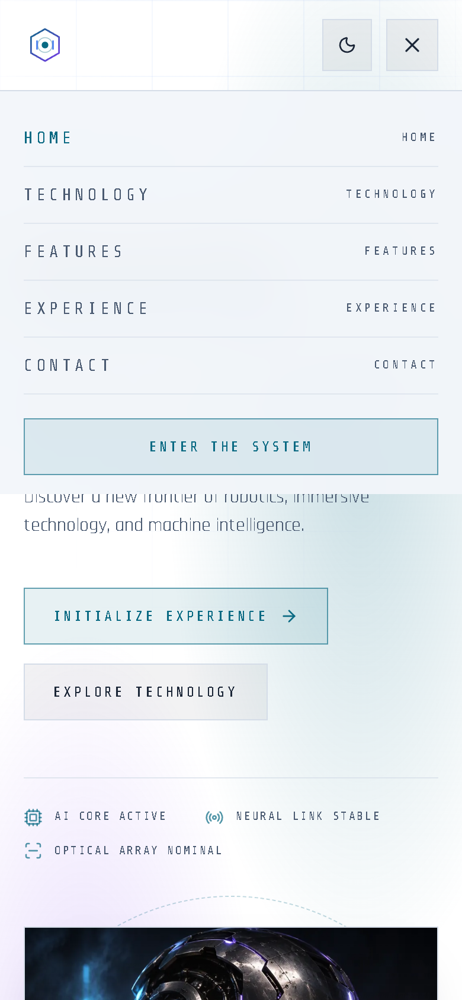 |

**Dark theme**

| Hero | Interactive panel | Modal dialog |
| --- | --- | --- |
| 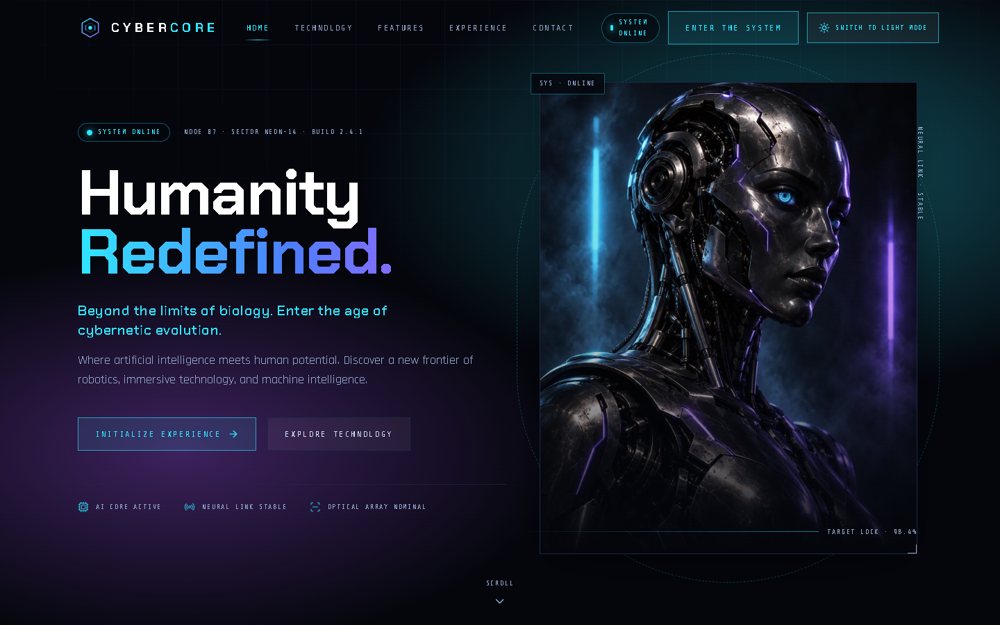 | 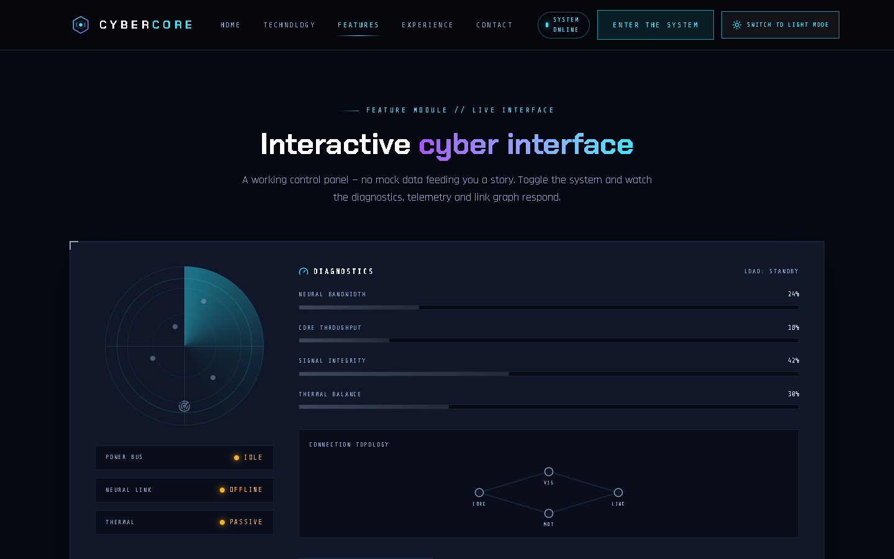 | 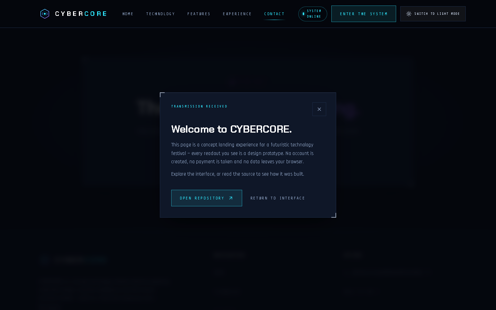 |

## Deployment

The build uses `base: './'`, so every asset is referenced relatively. The contents of `dist/` therefore work at a domain root **and** under a sub-path (e.g. GitHub project Pages) with no extra configuration.

**GitHub Pages (manual)**
1. `npm run build`
2. Publish the `dist/` folder — e.g. push it to a `gh-pages` branch:
   ```bash
   npm i -D gh-pages
   npx gh-pages -d dist
   ```
3. In the repository: **Settings → Pages → Branch: gh-pages / root**.

**Vercel / Netlify**
- Framework preset: **Vite**
- Build command: `npm run build`
- Output directory: `dist`
- No environment variables are required — the app has no backend, secrets or API keys.

Set the final `og:url`-style absolute URLs only if you add per-page canonical links later; the current `og:image` uses a relative path that resolves from the deployed page.

## Demo recording

Not generated automatically. To capture the submission clip (30–60 s):

1. `npm run dev` and open the printed URL.
2. Record the viewport (OBS Studio, or Windows `Win + Alt + R`).
3. Show the hero, click `SWITCH TO DARK MODE` and back, scroll through telemetry → technology → interactive panel, click `ACTIVATE SYSTEM`, then resize to a phone width (~390 px) and open the mobile menu.
4. Upload to Google Drive → **Share** → *Anyone with the link* / *Viewer* → verify the link opens in an incognito window.

## Credit & license

- Code is licensed under the **MIT License** — see [`LICENSE`](LICENSE).
- Imagery was generated for this project and stored locally in `src/assets/` and `public/`.
- Fonts are self-hosted latin subsets of Chakra Petch, Rajdhani and Share Tech Mono and remain under the **SIL Open Font License 1.1**, which the MIT grant does not override; keep their licence notice if you redistribute them.
